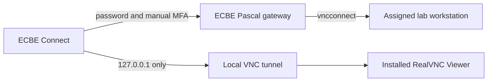

# ECBE Connect - Unofficial

ECBE Connect is an independent student project which helps authorized TMU ECBE students start
or find their departmental VNC desktop, keep its SSH tunnel alive, and open an installed VNC
viewer. The GUI and CLI use the same connection engine.

> **Unofficial software — use at your own risk.** ECBE Connect is an independent student project
> and is not affiliated with, endorsed by, sponsored by, or supported by Toronto Metropolitan
> University, the Department of Electrical, Computer, and Biomedical Engineering, or RealVNC
> Limited. Use this software only with an account and systems you are authorized to access, and
> only in accordance with applicable university policies and third-party terms. You are
> responsible for protecting your credentials, verifying connection details, maintaining
> backups, and complying with all applicable rules. The software is provided "as is," without
> warranties or guarantees of availability, security, compatibility, or fitness for a particular
> purpose. To the maximum extent permitted by law, the project’s authors and contributors are not
> liable for account restrictions, data loss, interrupted work, security incidents, or other
> damages arising from its use. Stop using the tool and contact ECBE technical support if its
> behaviour differs from official instructions.

This notice does not grant authorization, override TMU policy, or guarantee that every liability
limitation is enforceable.

## What it automates



- One SSH login to the current ECBE gateway.
- Interactive password and fresh six-digit verification-code prompts.
- Starting or finding a VNC session using the department's `vncconnect` utility.
- A loopback-only tunnel, normally at `127.0.0.1::5900`.
- Automatic launch of an installed RealVNC Viewer.
- GUI background operation through the notification area, menu bar, or system tray.
- Listing sessions, changing the separate VNC password, and stopping a selected session.

ECBE Connect does not store MFA seeds, bundle RealVNC, scan workstations, or provide arbitrary
remote-command execution.

## Five-minute start

1. Complete the [first-time ECBE setup](docs/first-time-ecbe-setup.md).
2. Install RealVNC Viewer from its [official download page](https://www.realvnc.com/en/connect/download/viewer/).
3. Download ECBE Connect from the canonical GitHub Releases page and verify its checksum.
4. Open the GUI, review the disclaimer, and enter your ECBE username.
5. Select **Connect and open VNC**. Supply your ECBE password and each fresh authenticator code.
6. Leave ECBE Connect running in the tray while using the remote desktop.

If the beta cannot complete the connection, follow the
[manual connection guide](docs/manual-connection.md) and report only sanitized diagnostics.

## Development

Python 3.12 is required for source development. End users of packaged releases do not need
Python.

```powershell
python -m venv .venv
python -m pip install uv
uv sync --locked --all-extras
uv run pytest
uv run ecbe-connect --help
uv run ecbe-connect-gui
```

The checked-in lockfile pins hashes for reproducible development and release environments.

## Project documentation

- [Using the app](docs/using-the-app.md)
- [First-time ECBE setup](docs/first-time-ecbe-setup.md)
- [Manual fallback](docs/manual-connection.md)
- [Troubleshooting](docs/troubleshooting.md)
- [Security and privacy](docs/security-and-privacy.md)
- [Uninstall and erase local data](docs/uninstall.md)
- [Sources](docs/sources.md)

Project-owned code is available under the [MIT License](LICENSE). Third-party components retain
their own licenses; see [third-party notices](THIRD_PARTY_NOTICES.md).
